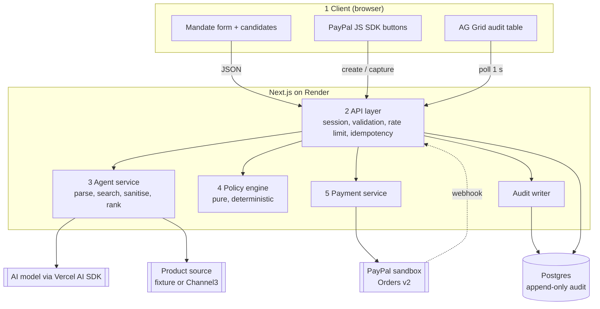
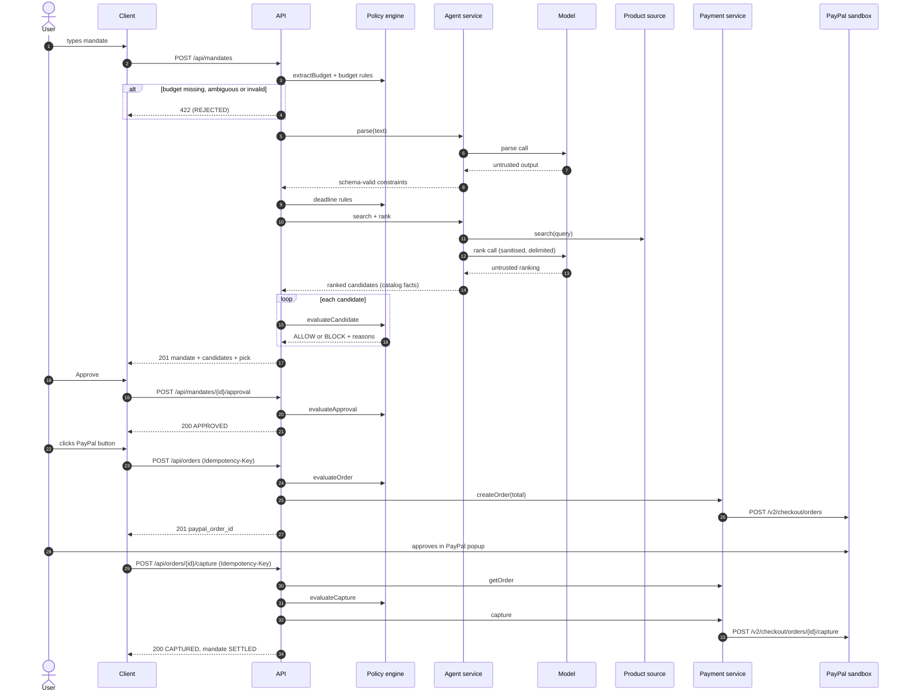

# 02 — Architecture

Version 1.0 · 9 Oct 2026

## Assumptions

1. One Next.js application (App Router, TypeScript strict) deployed as a single Render web service with one Render Postgres database. The five layers are modules inside it, not separate services.
2. A single running instance. In-memory rate limiting and in-flight idempotency locks rely on this.
3. Server-side PayPal calls use `fetch` against the Orders v2 REST API. The client uses the PayPal JS SDK buttons.
4. Drizzle ORM with SQL migrations is the database access layer.
5. Exact PayPal, Render and Channel3 behaviours are to be confirmed against their current documentation when each integration starts. A mismatch is a spec change, not a guess.

## 1. Layers

| # | Layer | Location | Responsibility | May import |
|---|---|---|---|---|
| 1 | Client | `src/app/(ui)`, `src/components` | Store catalog, agent conversation, approval, PayPal buttons, AG Grid audit table | API over HTTP only; the product search boundary for FR-028 |
| 2 | API | `src/app/api` | Session, origin check, rate limit, strict validation, idempotency, error envelope, orchestration | Agent, Policy, Payment, Audit, DB |
| 3 | Agent service | `src/agent` | Model adapter, mandate parsing, product search, sanitising, ranking | Policy (types only), Zod, AI SDK |
| 4 | Policy engine | `src/policy` | Budget extraction, mandate, candidate, approval, order and capture rules | **Nothing** outside `src/policy` |
| 5 | Payment service | `src/payment` | PayPal OAuth, create order, get order, capture, webhook verification | `fetch`, Zod |

Shared: `src/audit` (the only writer of audit events), `src/db` (schema, migrations), `src/lib` (logger, config, errors).

**Layer rules**

- The policy engine is pure: no I/O, no clock, no environment, no randomness. `now` and all data are arguments (NFR-003).
- The API layer reads the clock once per request and passes `now` to the mandate pipeline and the policy engine. No other layer reads the clock.
- The agent service never writes decisions and never calls the payment service.
- The payment service is called only from the API layer, and only after a policy ALLOW at that stage.
- The client never sends amounts, decisions or product facts.
- The page's server component may read the product source through the agent service's search boundary, for display only (FR-028).

## 2. Component diagram

## 3. Request flow

Every step that changes state appends an audit event (§5). The audit table polls `GET /api/audit` once per second.

## 4. Data model

All IDs are UUID v4 unless noted. Timestamps are `timestamptz` in UTC. Money is `integer` cents. Each table is created by the migration of the first requirement that uses it (M1: `audit_events` for FR-014, `sessions` for SEC-009).

### 4.1 `sessions`
| Column | Type | Notes |
|---|---|---|
| id | uuid PK | value carried in the signed cookie |
| created_at | timestamptz | |

### 4.2 `mandates`
| Column | Type | Notes |
|---|---|---|
| id | uuid PK | |
| session_id | uuid FK | |
| raw_text | text | as submitted |
| timezone | text | IANA |
| status | text | see §4.7 |
| max_total_cents | integer null | from budget extractor |
| currency | text null | |
| query | text null | from model |
| deliver_by | date null | from model |
| exclude_terms | text[] | default empty |
| reject_reasons | text[] | mandate-stage reason codes |
| pick_candidate_id | uuid null | |
| approved_candidate_id | uuid null | |
| approved_at | timestamptz null | |
| created_at | timestamptz | |

### 4.3 `candidates` (immutable after insert)
| Column | Type | Notes |
|---|---|---|
| id | uuid PK | |
| mandate_id | uuid FK | |
| product_id | text | source ID |
| title, merchant, category | text null | sanitised |
| image_url, product_url | text null | |
| price_cents, shipping_cents, tax_cents | integer null | catalog snapshot |
| total_cents | integer null | computed by policy engine; null if incomplete |
| currency | text null | |
| estimated_delivery_date | date null | |
| in_stock | boolean null | |
| rank | integer | 1 = best |
| rationale | text null | from model, plain text, ≤ 280 chars |
| decision | text | `ALLOW` or `BLOCK` |
| reason_codes | text[] | precedence order |
| policy_version | text | |

Unique: `(mandate_id, product_id)`, `(mandate_id, rank)`.

### 4.4 `orders`
| Column | Type | Notes |
|---|---|---|
| id | uuid PK | |
| mandate_id | uuid FK | |
| candidate_id | uuid FK | |
| paypal_order_id | text unique | |
| paypal_capture_id | text null | |
| amount_cents | integer | equals candidate `total_cents` |
| currency | text | |
| status | text | `CREATED`, `CAPTURED`, `FAILED` |
| created_at, updated_at | timestamptz | |

Partial unique indexes: one `CAPTURED` order per mandate; one `CREATED` order per mandate (FR-013).

### 4.5 `idempotency_keys`
| Column | Type | Notes |
|---|---|---|
| session_id, endpoint, key | PK (composite) | endpoint is `orders.create` or `orders.capture:{order_id}` |
| request_hash | text | SHA-256 of the canonical request body |
| state | text | `IN_PROGRESS` or `COMPLETED` |
| response_status | integer null | |
| response_body | jsonb null | |
| created_at | timestamptz | records older than 24 h are ignored |

### 4.6 `audit_events` (append-only) and `webhook_events`
| Column | Type | Notes |
|---|---|---|
| seq | bigserial PK | cursor |
| id | uuid | |
| ts | timestamptz | server time |
| session_id | uuid null | null for webhooks not matched to an order |
| mandate_id | uuid null | |
| actor | text | `USER`, `AGENT`, `POLICY`, `PAYMENT`, `SYSTEM` |
| event_type | text | see §5 |
| decision | text null | `ALLOW`, `BLOCK` or null |
| reason_codes | text[] | |
| payload | jsonb | event-specific; never secrets |
| prev_hash, hash | text | only if SEC-011 is delivered |

A database trigger raises an exception on UPDATE, DELETE or TRUNCATE (SEC-010).

`webhook_events`: `paypal_event_id` text PK, `event_type` text, `received_at` timestamptz. Used only for de-duplication (FR-023).

### 4.7 State machines

**Mandate**

| From | Event | To |
|---|---|---|
| (new) | mandate-stage rule fails | `REJECTED` |
| (new) | agent or search failure | `FAILED` |
| (new) | pick found | `PROPOSED` |
| (new) | no ALLOW candidate | `NO_ELIGIBLE_PRODUCT` |
| `PROPOSED` | user approves ALLOW candidate | `APPROVED` |
| `PROPOSED` | user declines | `DECLINED` |
| `APPROVED` | capture succeeds | `SETTLED` |
| `APPROVED` | approval expired at order time (FR-024) | `PROPOSED` |

`REJECTED`, `FAILED`, `NO_ELIGIBLE_PRODUCT`, `DECLINED`, `SETTLED` are terminal.

**Order**

| From | Event | To |
|---|---|---|
| (new) | PayPal order created | `CREATED` |
| `CREATED` | capture completed (sync or verified webhook) | `CAPTURED` |
| `CREATED` | capture declined, or `AMOUNT_MISMATCH` | `FAILED` |

A PayPal 5xx or network error leaves the order `CREATED`. `CAPTURED` and `FAILED` are terminal.

## 5. Audit events

| event_type | actor | When | decision |
|---|---|---|---|
| `MANDATE_RECEIVED` | USER | mandate stored | – |
| `MANDATE_REJECTED` | POLICY | mandate-stage rule fails | BLOCK |
| `MANDATE_PARSED` | AGENT | constraints validated | – |
| `SEARCH_COMPLETED` | AGENT | products returned | – |
| `POLICY_DECISION` | POLICY | one per candidate | ALLOW / BLOCK |
| `PICK_PROPOSED` | AGENT | pick selected | – |
| `NO_ELIGIBLE_PRODUCT` | POLICY | no ALLOW candidate | BLOCK |
| `AGENT_ERROR` | AGENT | model or search failure, or fallback used | – |
| `USER_APPROVED` | USER | approval accepted | ALLOW |
| `APPROVAL_BLOCKED` | POLICY | approval refused | BLOCK |
| `USER_DECLINED` | USER | mandate declined | – |
| `ORDER_BLOCKED` | POLICY | order or capture refused by policy | BLOCK |
| `ORDER_CREATED` | PAYMENT | PayPal order created | ALLOW |
| `ORDER_CAPTURED` | PAYMENT | capture completed | ALLOW |
| `ORDER_FAILED` | PAYMENT | capture declined or provider error | – |
| `WEBHOOK_RECEIVED` | PAYMENT | verified webhook processed | – |

**Order of events for an approved purchase (IT-AUD-001):** `MANDATE_RECEIVED`, `MANDATE_PARSED`, `SEARCH_COMPLETED`, `POLICY_DECISION` × N (rank order), `PICK_PROPOSED`, `USER_APPROVED`, `ORDER_CREATED`, `ORDER_CAPTURED`.

## 6. Client

One route, `/`. A header shows the product name and a "Sandbox" label. Below it are three regions. The store and agent panels sit side by side at 768 px and wider, and stack below that.

1. **Store panel:** the product catalog as a grid of tiles (FR-028). Tiles are display only.
2. **Agent panel:** a conversation thread and a composer.
   - The composer has a labelled text field, a send control and the sample mandates (FR-027).
   - The thread shows, in order: the user's mandate as a message; the parsed constraints (budget, deadline, exclusions); candidate cards in rank order, each with title, merchant, total with breakdown, delivery date, rationale, decision text, reason codes and a plain-language reason; Approve on ALLOW cards and Decline for the mandate; the PayPal button after approval; a settled message with the PayPal order ID.
   - Errors appear in the thread as an agent message announced to assistive technology.
   - The thread holds one mandate. Sending a new mandate starts a new thread.
3. **Audit panel:** AG Grid Community table, full width below the other two and always visible. Columns: seq, time, actor, event, decision, reason codes, product, amount, PayPal order ID. New rows are added with grid transactions from the polled cursor.

The agent answers once per mandate. There is no follow-up conversation.

Styling uses the system font stack and no external fonts or images, so the Content-Security-Policy is unchanged. PayPal's name and marks appear only inside PayPal's own SDK button and popup.

The client holds one idempotency key per approval for order creation and one per order for capture, and reuses it on retry. It generates a new order-creation key only after an order reaches `FAILED`.

## 7. Trade-offs

| Decision | Chosen | Alternative | Why |
|---|---|---|---|
| Deployment shape | One Next.js app, layers as modules | Separate services | One deploy and one log stream fit a five-week solo build; module import rules keep the boundaries |
| Live audit transport | 1 s polling with a `seq` cursor | SSE or WebSocket | No long-lived connections to manage on one instance; meets the 2 s target |
| Mandate request | One synchronous call (parse, search, rank, evaluate) | Async job with status polling | Simpler contract; bounded by a 12 s deadline; progress is still visible through audit polling |
| Budget source | Deterministic extractor on raw text | Model extracts budget | The limit cannot be altered by any prompt; cost is rejecting amounts written as words |
| Evaluation order | Rank all candidates, then evaluate all | Filter first, rank only eligible | Blocked candidates and their reasons are visible, which is the product's point; cost is a larger rank prompt |
| Product facts | Joined from catalog by ID | Model returns product objects | Removes hallucinated or injected prices |
| Default catalog | Bundled fixture | Live search only | Deterministic demo, eval and tests; Channel3 stays optional |
| Rate limiting | In-memory fixed window | Postgres or Redis | No extra infrastructure; valid for one instance only |
| Approval and payment | Separate in-app approval, then PayPal approval | PayPal button as the only approval | Human approval is an explicit audited policy input, independent of the payment provider |
| Order amount | Stored candidate snapshot | Re-fetch price at order time | Sandbox merchant of record; avoids price drift between approval and capture |
| Data access | Drizzle ORM | Raw SQL | Typed queries and migrations with little code |

## 8. Approved dependencies

Runtime: `next`, `react`, `react-dom`, `zod`, `ai`, one AI SDK provider package for the configured provider, `drizzle-orm`, `pg`, `ag-grid-community`, `ag-grid-react`, `@paypal/react-paypal-js`.

Development: `typescript`, `drizzle-kit`, `vitest`, `@vitest/coverage-v8`, `@playwright/test`, `@axe-core/playwright`, `eslint`, `eslint-config-next`, `prettier`, `@types/node`, `@types/react`, `@types/react-dom`, `@types/pg`.

Anything else requires a spec change (see `CLAUDE.md`).

## 9. Configuration

| Variable | Secret | Purpose |
|---|---|---|
| `DATABASE_URL` | yes | Postgres connection |
| `SESSION_SECRET` | yes | cookie signing key, ≥ 32 bytes |
| `APP_URL` | no | public origin, used for the origin check |
| `PAYPAL_ENV` | no | must be `sandbox` |
| `PAYPAL_CLIENT_ID`, `PAYPAL_CLIENT_SECRET` | secret is | server PayPal credentials |
| `NEXT_PUBLIC_PAYPAL_CLIENT_ID` | no | client SDK |
| `PAYPAL_WEBHOOK_ID` | no | webhook verification (FR-023) |
| `AI_PROVIDER`, `AI_MODEL` | no | adapter selection |
| `AI_API_KEY` | yes | provider key |
| `SEARCH_PROVIDER` | no | `fixture` (default) or `channel3` |
| `CHANNEL3_API_KEY` | yes | FR-026 only |
| `DAILY_MANDATE_CAP` | no | SEC-015 only |
| `LOG_LEVEL` | no | default `info` |
| `RENDER_GIT_COMMIT` | no | deploy commit SHA, set automatically by Render; reported by `/api/healthz` (FR-020) |

Configuration is validated with Zod at startup. Missing or invalid required values stop the process. A variable becomes required in the milestone that first uses it. In M1 the required variables are `DATABASE_URL`, `SESSION_SECRET`, `APP_URL` and `RENDER_GIT_COMMIT`; `LOG_LEVEL` is optional.
